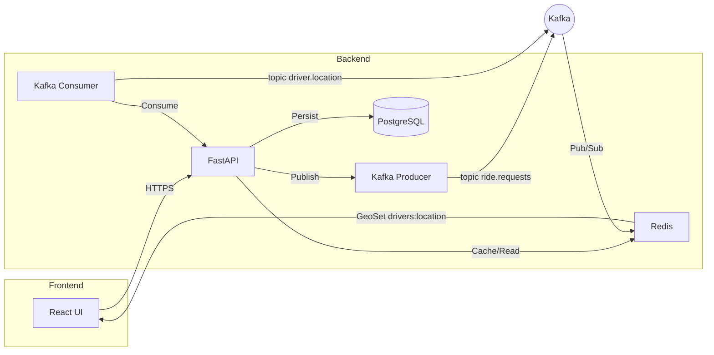

# Software Requirement Specification (SRS)
## Ride Booking System – Real‑time Kafka‑Redis Integration

**Document version:** 1.0
**Date:** 2026‑11‑01

---

### 1. Introduction
**1.1 Purpose**
Define functional and non‑functional requirements for the Ride Booking System, including future real‑time event streaming via Apache Kafka and state caching/pub‑sub with Redis.

**1.2 Scope**
Three logical components:
- Frontend (React/TSX) UI
- Backend (FastAPI, PostgreSQL)
- Real‑time Integration Layer (Kafka + Redis)

**1.3 Definitions**
- **Kafka** – Distributed streaming platform.
- **Redis** – In‑memory data store used for caching and Pub/Sub.
- **SRS** – Software Requirements Specification.

**1.4 References**
- IEEE Std 830‑1998 – Recommended Practice for SRS
- Kafka docs: https://kafka.apache.org/documentation/
- Redis docs: https://redis.io/docs/
- Project repo: `c:\\Users\\panka\\Desktop\\RideBookingSystem`

---

### 2. Overall Description
**2.1 Product Perspective**
Standalone web application communicating with external Kafka and Redis services.

**2.2 Product Functions**
1. User Management (signup, login, profile)
2. Ride Request Flow (create, match, start, complete)
3. Real‑time Updates (location, status) via Kafka/Redis
4. Admin Dashboard (monitoring, analytics)

**2.3 User Classes**
| Role | Description |
|------|-------------|
| Passenger | Requests rides via UI |
| Driver | Accepts rides, streams location |
| Admin | Oversees system health |
| DevOps | Deploys and configures Kafka/Redis |

**2.4 Operating Environment**
- Frontend: Modern browsers (Chrome/Edge/Firefox)
- Backend: Python 3.11, FastAPI, PostgreSQL
- Kafka: TLS, SASL, ≥3 brokers, replication 3
- Redis: Cluster mode, TLS, `allkeys‑lru` eviction

**2.5 Constraints**
- Keep existing project structure.
- All config in `.env`.
- Compatibility with Node 20 and Python 3.11.

---

### 3. System Features
#### 3.1 Ride Request Service
- **REST endpoint** `/api/rides/request`
- Validate payload, persist to PostgreSQL, publish `ride.requested` to Kafka, store status in Redis hash `ride:{ride_id}`.
- **Performance**: ≤200 ms response under 500 cps.

#### 3.2 Driver Matching Service
- Kafka consumer `driver-matcher` on `ride.requests`.
- Run matchmaking, publish `ride.assigned`, update Redis `ride:{ride_id}`.

#### 3.3 Real‑time Location Streaming
- Driver app publishes to `driver.location` (JSON) every 2 s.
- Backend consumes, updates Redis GEO set `drivers:location`.
- Passenger UI receives updates via Server‑Sent Events reading from Redis channel `ride:{ride_id}:location`.

#### 3.4 Administrative Dashboard
- Query Redis for active rides (`SCAN ride:*`).
- Show Kafka lag via JMX.
- Export CSV reports.

---

### 4. External Interface Requirements
#### 4.1 User Interfaces
- Web UI built with React, dark‑mode palette, Google Font *Inter*.
- API documented with OpenAPI 3.0.

#### 4.2 Software Interfaces
| Interface | Protocol | Description |
|-----------|----------|-------------|
| Kafka Broker(s) | TCP/TLS | Event streaming for rides & locations |
| Redis Cluster | TCP/TLS | Cache, GEO, Pub/Sub |
| PostgreSQL | PostgreSQL | Persistent storage |

#### 4.3 Communications
- All external traffic over HTTPS/TLS.
- JWT for REST authentication.
- Kafka SASL/SCRAM, Redis ACLs.

---

### 5. Architecture & Data Flow

---

### 6. Non‑functional Requirements
| Category | Requirement |
|----------|-------------|
| Performance | 99‑percentile latency ≤ 300 ms for ride flow; location updates ≤ 100 ms end‑to‑end |
| Scalability | Kafka partitions ≥ 12; Redis cluster ≥ 3 shards; stateless backend pods (Docker/K8s) |
| Reliability | Uptime ≥ 99.9 %; Kafka replication 3; Redis Sentinel failover |
| Security | TLS everywhere; JWT auth; Redis ACLs; Kafka SASL/SCRAM |
| Maintainability | Code coverage ≥ 80 %; linting (`ruff`, `eslint`) |
| Portability | Deploy via Docker Compose & Helm |
| Compliance | GDPR‑compliant data handling; ride logs retained ≤ 30 days |

---

### 7. Future Real‑time Integration Details
- **Kafka Topics**: `ride.requests`, `ride.assigned`, `driver.location`, `ride.events`.
- **Message Schemas**: Avro or JSON Schema stored in Confluent Schema Registry (future).
- **Redis Structures**:
  - Hash `ride:{id}` – status, driver, timestamps.
  - GEO set `drivers:location` – driver lat/long for nearest‑driver lookup.
  - Pub/Sub channel `ride:{id}:location` – push location updates to passenger.
- **Fault Tolerance**:
  - On consumer crash, replay from last committed offset.
  - Use Redis `EXPIRE` on temporary keys (e.g., location) to avoid stale data.
- **Monitoring**:
  - Kafka metrics via Prometheus JMX exporter.
  - Redis INFO metrics exported to Prometheus.
  - End‑to‑end latency alerts in Grafana.

---

### 8. Appendices
**A. Glossary**
- **Topic** – Kafka logical channel.
- **Partition** – Sub‑division of a topic for parallel consumption.
- **GEOSET** – Redis structure for geospatial queries.

**B. Revision History**
| Version | Date | Author | Comments |
|---------|------|--------|----------|
| 1.0 | 2026‑11‑01 | Antigravity | Initial custom SRS covering full project and Kafka‑Redis integration |

*End of Document*
